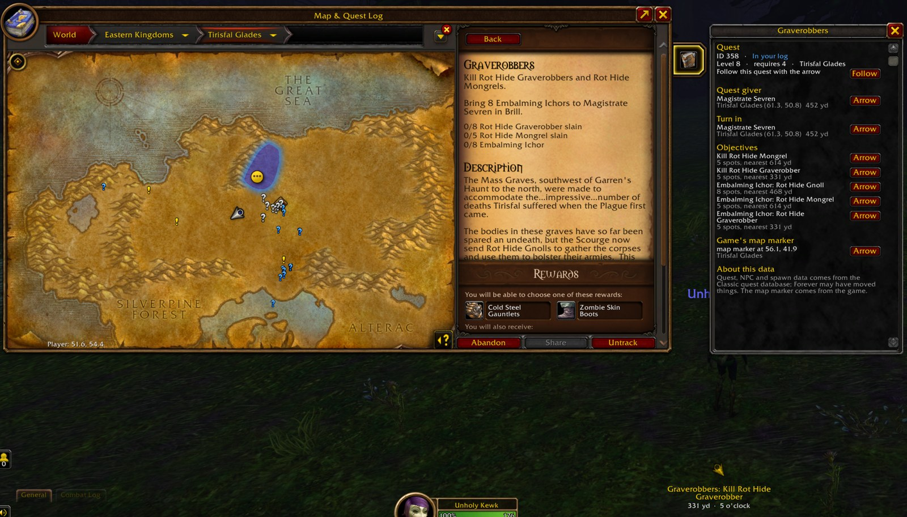

# KewkyQuest

Quest helper for WoW Forever: a route through nearby quests, a navigation arrow that follows your
tracked quest, a sparkle on quest objects, and a Quest Info tab on the Map & Quest Log.

- **Arrow:** click a quest in the objective tracker (or `/kq route`) and an arrow at the top of the screen
  points the way with the distance and a clock direction. It follows each step: the nearest open
  objective spot, the game's own map marker when the next step isn't in the database, then the turn-in.
  Drag it to move it, right-click to clear it.
- **Route panel:** `/kq` lists quests to pick up and turn in nearby; `/kq route` walks them with the arrow.
- **Quest Info tab:** a tab on the right edge of the Map & Quest Log (open by default, so `M` shows it)
  with what the addon knows about the open quest: quest giver and turn-in with distances, objective spots,
  the game's map marker, the quest chain and your turn-in history, each with an Arrow button.
- **Sparkle:** when the game soft-targets an interactable object that one of your quests needs (box parts,
  branches, chests), a gold sparkle plays on it. This turns on the game's soft-interact targeting
  (nearest object around you, 20 yd); `/kq sparkle` turns it off and restores your settings.
- `/kq why` explains where the arrow is pointing and why; `/kq done` lists completed quests.

The quest data is the Classic quest database, and Forever has changed and added quests, so some NPCs
and spots may be off; the game's own map marker is used whenever the database has nothing better.

## Install

1. Download **[KewkyQuest.zip](https://github.com/KewkLW/KewkyWoWForeverAddons/releases/latest/download/KewkyQuest.zip)**.
2. Extract it into `World of Warcraft/_forever_/Interface/AddOns/`, so you end up with
   `AddOns/KewkyQuest/KewkyQuest.toc`.
3. Restart the game (new addons only load after a full restart, not `/reload`).

## License

GPLv3 (`LICENSE.md`). Quest data is converted from Questie's database and objective spawns come from
wowforever-waypoint-tracker (MIT, with All The Things and pfQuest data); see `THIRD-PARTY-LICENSES.txt`.
