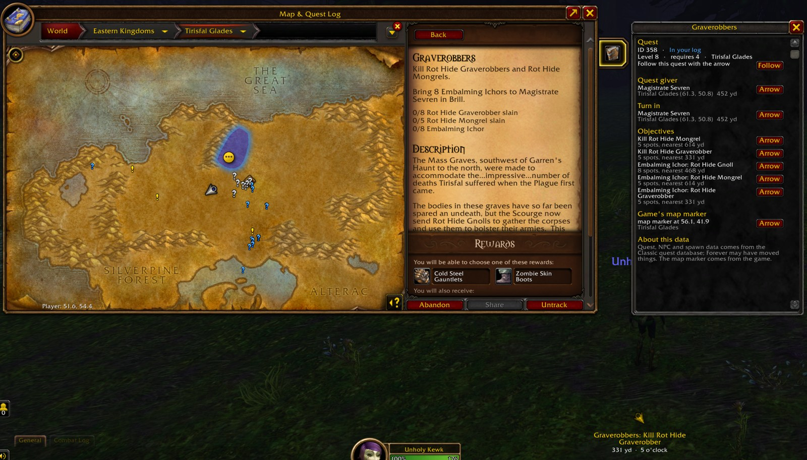

# Kewky WoW Forever Addons

Small addons for World of Warcraft: Forever.

| Addon | What it does | Download |
|---|---|---|
| [KewkyQuest](KewkyQuest) | Quest arrow that follows each step, quest route, sparkle on quest objects, Quest Info tab on the map (GPLv3) | [KewkyQuest.zip](https://github.com/KewkLW/KewkyWoWForeverAddons/releases/latest/download/KewkyQuest.zip) |
| [KewkyDeathNote](KewkyDeathNote) | Every player who killed you and every player you killed or helped kill, with both levels; red glow and K/D on your target; alert (sound optional) when the other faction is near, shared with addon users in your zone as map pins | [KewkyDeathNote.zip](https://github.com/KewkLW/KewkyWoWForeverAddons/releases/latest/download/KewkyDeathNote.zip) |
| [KewkyFriends](KewkyFriends) | Shows each Battle.net friend's ruleset and faction, and whether you can group with them | [KewkyFriends.zip](https://github.com/KewkLW/KewkyWoWForeverAddons/releases/latest/download/KewkyFriends.zip) |
| [KewkyChatTarget](KewkyChatTarget) | Adds Target to the right-click menu on player names in chat | [KewkyChatTarget.zip](https://github.com/KewkLW/KewkyWoWForeverAddons/releases/latest/download/KewkyChatTarget.zip) |

All of them in one zip: **[KewkyWoWForeverAddons.zip](https://github.com/KewkLW/KewkyWoWForeverAddons/releases/latest/download/KewkyWoWForeverAddons.zip)**

## Install

1. Download a zip above.
2. Extract it into `World of Warcraft/_forever_/Interface/AddOns/`. Each addon is a folder with a
   `.toc` file of the same name inside, e.g. `AddOns/KewkyFriends/KewkyFriends.toc`.
3. Restart the game. New addons only load after a full restart, not `/reload`.

To update, download again and replace the folders, then `/reload`.

## Licenses

KewkyQuest is GPLv3 because it bundles quest data converted from Questie; its folder has the licence
and third-party notices. The other addons are Kewk's own code.
